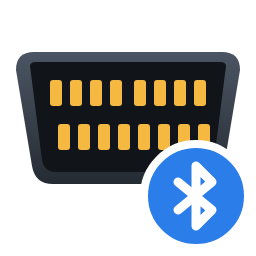

# ELM327 OBD-II over Bluetooth LE for Home Assistant

A Home Assistant custom integration that reads a car's engine data from a
**Bluetooth LE ELM327 OBD-II dongle** through Home Assistant's own
Bluetooth stack - a local adapter or any **ESPHome Bluetooth proxy**. Each
car has a *profile*: a small table of what to ask the engine computer and
how to decode the answers, including manufacturer-specific requests.

> **Please read:** this integration was generated by
> [Claude](https://claude.ai) (Anthropic's AI assistant) for my personal use.
> I'm happy to share it in case it's useful to someone else, but it's
> provided as-is and **no support will be provided**. Issues and pull
> requests may not be answered. Use at your own risk.

## Profiles included

| Profile | Readings |
|---|---|
| Holden / Chevrolet Captiva (diesel) | DPF soot load, km since DPF regeneration (GM-specific), plus the standard set |
| Mazda CX-5 (petrol) | Standard set |

**Standard set** (SAE J1979 mode 01): check-engine light, fault code
count, coolant temperature, fuel level, km since fault codes were cleared,
ambient temperature. A car that doesn't answer a request simply leaves
that sensor empty.

Every dongle also gets **OBD port voltage**, **Engine running** and **Last
engine reading** (when the engine data is from; its attributes show when
the dongle last answered and the last error).

## How it works

- **Parked:** every 2 minutes it connects briefly, asks the dongle for the
  battery voltage (`ATRV` - measured by the dongle itself, so it doesn't
  wake the car's computers) and disconnects. It never holds a connection
  while parked, so the dongle can sleep and doesn't drain the battery.
- **Engine running** (port voltage at or above 13.2 V, i.e. the alternator
  is charging): it stays connected, re-checks every 10 seconds and reads
  the profile's requests every minute until the engine stops.
- When the dongle is heard advertising (many wake when the car starts), it
  checks straight away instead of waiting.
- Readings keep their last value while the car is away or the dongle
  sleeps, and across Home Assistant restarts (*Engine running* excepted:
  it is re-checked straight away).
- Home Assistant picks whichever connectable adapter or proxy hears the
  dongle best.

## Supported dongles

Any Bluetooth **LE** ELM327 dongle with a serial-style GATT service should
work. Detected automatically:

- Generic "OBD2 BLE" dongles (service `FFF0`, characteristics `FFF1` /
  `FFF2`)
- Vgate iCar Pro BLE / 2S
- LeLink and other HM-10 style dongles (service `FFE0`)
- Otherwise: the first service with a notify and a write characteristic

Bluetooth *Classic* (SPP) dongles are not supported.

## Requirements

- Home Assistant 2025.1 or later with the **Bluetooth** integration set up.
- A **connectable** Bluetooth adapter or proxy within range of where the
  car parks - e.g. an [ESPHome Bluetooth proxy](https://esphome.io/components/bluetooth_proxy.html)
  with `active: true`. Passive-only scanners can't connect.

## Installation

**HACS (custom repository):** HACS → ⋮ → *Custom repositories* → add
`https://github.com/scottbambrick/ha-elm327-obd-ble` as an *Integration*
→ install → restart Home Assistant.

**Manual:** copy `custom_components/elm327_ble` into your Home Assistant
`config/custom_components/` folder and restart.

## Setup

*Settings → Devices & services → Add integration → ELM327 OBD-II over
Bluetooth LE*, then enter a name (e.g. "Car OBD"), the dongle's Bluetooth
address (e.g. `AA:BB:CC:DD:EE:FF` - find it in Home Assistant's Bluetooth
advertisement monitor while the car is on) and the car's profile.

## Adding a car

Profiles live in
[`custom_components/elm327_ble/profiles.py`](custom_components/elm327_ble/profiles.py).
A profile is a list of `Pid` entries - the request, the positive-reply
prefix, the number of data bytes and a decode function - for example:

```python
Pid("coolant_temperature", "0105", "4105", 1, lambda b: b[0] - 40)
```

Add a `Profile` to `PROFILES` (and a `SensorEntityDescription` in
`sensor.py` for any new value key). The default setup commands select CAN
11-bit 500 kbit/s and the engine ECU (`ATSP6`, `ATSH7E0`); override
`init` for cars that need something else.

## Notes

- Only one app can talk to a dongle at a time: close any phone OBD app.
- Debug logging:
  ```yaml
  logger:
    logs:
      custom_components.elm327_ble: debug
  ```

## Licence

[MIT](LICENSE).

## Development

The protocol code is covered by unit tests that run without Home Assistant:

```sh
pip install pytest cryptography
pytest
```

GitHub Actions runs them, `ruff`, `hassfest` and the HACS validation on
every push.
